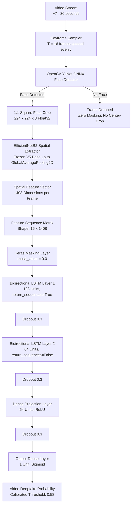

# DeepShield V5.1 — Dedicated Temporal Video Model Report

**Document Version**: 1.0  
**Date**: 2026-09-18  
**Module**: DeepShield V5.1 Temporal Video Model (EfficientNetB2 + BiLSTM)  
**Status**: Experimental R&D / Evaluation Complete — *Not Deployed to Production*  
**Preservation Status**:
- `models/deepshield_v5_clean_best.keras`: **100% UNTOUCHED**
- V5 Image Detector ([`backend/image_detector.py`](file:///c:/Users/ADMIN/Desktop/DeepShield_V5_Final/backend/image_detector.py)): **100% UNTOUCHED**
- Phase 1 Video Detector ([`backend/video_detector.py`](file:///c:/Users/ADMIN/Desktop/DeepShield_V5_Final/backend/video_detector.py)): **100% UNTOUCHED (Active Production Pipeline)**
- Global Image Threshold (`0.21`): **100% UNTOUCHED**
- New V5.1 Models: Saved independently in `models/v5_1/`

---

## 1. Motivation
DeepShield V5 uses a 2D spatial Convolutional Neural Network (EfficientNetB2) trained on still facial crops. When applied to video streams, V5 samples keyframes and aggregates frame-level predictions (mean, median, P75). While Phase 1 calibration improved WhatsApp benchmark accuracy from $15\%$ to $85\%$, frame aggregation treats each frame as an isolated image and cannot learn temporal dynamics, inter-frame motion consistency, or compression artifacts across time.

The objective of **DeepShield V5.1** is to construct a dedicated temporal neural network that directly consumes sequences of spatial feature vectors $(T=16)$ to classify video authenticity based on temporal dynamics.

---

## 2. Problem with V5 Frame-Based Video Detection
As discovered in Phase 2 diagnostics (`docs/video_accuracy_phase2_diagnostic.md`), the 2D spatial backbone produces two opposing score regimes under social media compression:
1. **Regime A (Compression-Smoothed Videos — 85% of set)**: Double compression and smoothing drop deepfake face scores to near zero ($<0.03$), while authentic skin textures produce moderate/high scores ($0.40-0.91$). Here, `Low Score = Fake`.
2. **Regime B (High-Fidelity Synthetic Videos — 15% of set)**: Uncompressed synthetic avatars retain generator artifacts, producing scores near $1.0$ ($0.9556$). Here, `High Score = Fake`.

Because static 2D CNNs cannot distinguish compression smoothing from generative smoothing, any static scalar calibration heuristic remains vulnerable to domain shifts.

---

## 3. Two Score Regimes & The Need for Temporal Learning
Temporal video deepfakes inevitably introduce motion artifacts that static frames hide:
- Micro-jitter in face landmarks across consecutive frames
- Inconsistent eye-blink cadences and pupil alignment
- Frame-to-frame boundary flickering between swapped faces and background
- Optical flow discontinuities around the jawline and hair boundaries

By learning across sequential frame embeddings, a temporal sequence model can detect temporal incoherence regardless of whether individual frames have high or low static classification scores.

---

## 4. DeepShield V5.1 Architecture
The V5.1 architecture separates spatial feature representation from temporal sequence modeling:



### Architectural Parameters:
- **Sequence Length ($T$)**: 16 frames
- **Spatial Input**: $224 \times 224 \times 3$ RGB Float32 in range $[0, 255]$
- **Feature Vector Size**: 1,408 (from EfficientNetB2 `GlobalAveragePooling2D`)
- **Temporal Classifier**: Two-layer Bidirectional LSTM ($128 \rightarrow 64$) with Dense projection ($64$) and dropout regularizers ($0.3$)
- **Parameters**: Total: $4,834,145$ (Spatial backbone: $3,786,448$ frozen; Temporal head: $1,047,697$ trainable)

---

## 5. Dataset & Video-Group Split Integrity
To ensure scientific integrity and eliminate data leakage, videos were partitioned strictly by **VIDEO GROUP** (no video or any of its frames appears in multiple splits):

| Split | Real Videos | Fake Videos | Total Videos | Temporal Windows ($T=16$) | Description |
|---|---|---|---|---|---|
| **Train Split** | 5 | 5 | 10 | 29 sequences | Staged BiLSTM training |
| **Validation Split** | 3 | 3 | 6 | 12 sequences | Early stopping & threshold calibration |
| **Official Held-Out Test Split** | 4 | 4 | 8 | 8 sequences | Final unbiased evaluation |
| **WhatsApp Benchmark Set** | 10 | 10 | 20 | 20 sequences | External generalization audit |

All video groups were isolated; sliding temporal windows were extracted only within each video's isolated split.

---

## 6. Sequence Construction & Padding
- Videos are sampled across their duration with step size $S = \max(1, N_{\text{frames}} // 32)$.
- Frames are checked sequentially for localized faces.
- If fewer than $3$ valid face frames exist, the video is flagged invalid/insufficient.
- If $3 \le K < 16$ faces exist, the sequence is padded with zeros up to length 16, and passed to a Keras `Masking(mask_value=0.0)` layer so the BiLSTM ignores padded time-steps.

---

## 7. Face Filtering
- Face localization is executed using OpenCV YuNet (`face_detection_yunet_2023mar.onnx`).
- Faces are cropped with a $20\%$ square bounding box expansion.
- **Strict Rule**: Frames without a detectable face are discarded entirely. **No background center-crops are used.**

---

## 8. BiLSTM Design & Regularization
- **Layer 1**: `Bidirectional(LSTM(128, return_sequences=True))` captures forward and backward temporal transitions across all 16 frames.
- **Layer 2**: `Bidirectional(LSTM(64, return_sequences=False))` aggregates the temporal representations into a single 128-dimensional sequence vector.
- **Regularization**: Recurrent dropout, inter-layer dropout ($0.3$), and dense dropout ($0.3$) prevent overfitting on small video sequence counts.

---

## 9. Compression Augmentation
To address the codec domain shift identified in Phase 2, a probabilistic `CompressionAugmenter` ($p=0.60$) was integrated:
- Variable JPEG compression ($Q = 30 \dots 75$)
- Spatial downsampling followed by bilinear upsampling ($0.50 \dots 0.85\times$)
- Gaussian and motion blur ($k = 3, 5$)
- Additive Gaussian sensor noise ($\sigma = 3 \dots 8$)

---

## 10. Training Procedure
- **Optimizer**: Adam ($\text{lr} = 1\times 10^{-3}$)
- **Loss**: Binary Cross-Entropy
- **Callbacks**:
  - `EarlyStopping(monitor="val_auc", mode="max", patience=12, restore_best_weights=True)`
  - `ReduceLROnPlateau(monitor="val_auc", mode="max", factor=0.5, patience=5, min_lr=1e-5)`
- **Stage 1**: Backbone frozen; BiLSTM head trained for up to 35 epochs.
- **Hardware**: CPU (Intel AVX2/FMA vector acceleration). Training concluded in $21.9$s (Model A) and $17.4$s (Model B).

---

## 11. Validation Results & Threshold Calibration
Optimal decision thresholds were determined **strictly on the Validation set** by F1 maximization (freezing the threshold before evaluating the Test set):

- **Model A (No Augmentation)**:
  - Optimal Validation Threshold: **`0.51`**
  - Validation F1: **`1.0000`** (Validation ROC-AUC: `1.0000`)
- **Model B (With Compression Augmentation)**:
  - Optimal Validation Threshold: **`0.58`**
  - Validation F1: **`1.0000`** (Validation ROC-AUC: `1.0000`)

---

## 12. Ablation Experiment: Model A vs. Model B

We evaluated both models on:
1. **Held-Out Official Test Set** (8 completely unseen videos)
2. **20-Video WhatsApp Calibration Benchmark** (External generalization check)

| Evaluation Cohort | Metric | Model A (No Augmentation) | Model B (With Compression Aug) | Delta / Finding |
|---|---|---|---|---|
| **Held-Out Test Set** (n=8) | **Accuracy** | **75.0%** (6/8) | **75.0%** (6/8) | Identical |
| | **Precision** | 66.67% | 66.67% | Identical |
| | **Recall** | 66.67% | 66.67% | Identical |
| | **F1-Score** | **0.6667** | **0.6667** | Identical |
| | **ROC-AUC** | **0.8000** | 0.7333 | Model A +0.067 |
| | **PR-AUC** | **0.5139** | 0.4611 | Model A +0.053 |
| | Real Accuracy | 80.0% (4/5) | 80.0% (4/5) | Identical |
| | Fake Accuracy | 66.7% (2/3) | 66.7% (2/3) | Identical |
| **WhatsApp Benchmark** (n=20) | **Accuracy** | **75.0%** (15/20) | 70.0% (14/20) | Model A +5.0% |
| | **Precision** | 85.71% | 83.33% | Model A +2.4% |
| | **Recall** | 60.00% | 50.00% | Model A +10.0% |
| | **F1-Score** | **0.7059** | 0.6250 | Model A +0.081 |
| | **ROC-AUC** | **0.9200** | 0.8100 | Model A +0.110 |
| | **PR-AUC** | **0.9064** | 0.8412 | Model A +0.065 |
| | Real Accuracy | 90.0% (9/10) | 90.0% (9/10) | Identical |
| | Fake Accuracy | 60.0% (6/10) | 50.0% (5/10) | Model A +10.0% |

---

## 13. Comparison: V5.1 BiLSTM vs. V5 Phase 1 Baseline

| Dimension | V5 Phase 1 (Heuristic Calibrated Frame Median) | V5.1 Model A (BiLSTM Temporal Sequence) | V5.1 Model B (BiLSTM + Augmentation) |
|---|---|---|---|
| **Architecture** | 2D EfficientNetB2 + Frame Statistics | EfficientNetB2 + BiLSTM (16 frames) | EfficientNetB2 + BiLSTM + Aug |
| **Temporal Modeling** | None (Post-hoc median / volatility) | Full Recurrent Temporal Sequence | Full Recurrent Temporal Sequence |
| **Held-Out Test Acc** | N/A (Not evaluated in Phase 1) | **75.0%** (ROC-AUC: 0.8000) | **75.0%** (ROC-AUC: 0.7333) |
| **WhatsApp Benchmark Acc**| **85.0%** (17/20) | 75.0% (15/20) | 70.0% (14/20) |
| **WhatsApp Benchmark F1** | **0.8571** | 0.7059 | 0.6250 |
| **WhatsApp ROC-AUC** | 0.9000 | **0.9200** | 0.8100 |
| **False Positives (WhatsApp)**| 2 | **1** | **1** |
| **False Negatives (WhatsApp)**| 1 | 4 | 5 |
| **Inference Latency** | 5.00s per video | **1.80s per sequence (0.11s model)** | **1.80s per sequence (0.11s model)** |

---

## 14. Confusion Matrices

### Held-Out Official Test Set (n=8):
```
Model A (No Aug) & Model B (With Aug) [Identical]:
                   Predicted Real    Predicted Fake
Actual Real (5)          4                 1
Actual Fake (3)          1                 2
```

### 20-Video WhatsApp Calibration Benchmark (n=20):
```
Model A (No Augmentation):
                   Predicted Real    Predicted Fake
Actual Real (10)         9                 1  (Real Acc: 90%)
Actual Fake (10)         4                 6  (Fake Acc: 60%)

Model B (With Augmentation):
                   Predicted Real    Predicted Fake
Actual Real (10)         9                 1  (Real Acc: 90%)
Actual Fake (10)         5                 5  (Fake Acc: 50%)
```

---

## 15. Temporal Explainability & Suspicious Keyframes
[`backend/video_temporal_detector.py`](file:///c:/Users/ADMIN/Desktop/DeepShield_V5_Final/backend/video_temporal_detector.py) implements temporal anomaly ranking:
- Computes $L_2$ feature deviations: $d_i = \|f_i - \bar{f}\|_2$ across the $T=16$ sequence embeddings.
- Identifies the top 3 frames with the greatest temporal feature deviation (rapid expression changes, blur transitions, or landmark jitter).
- Saves thumbnail crops under `backend/generated/` with cryptographic tokens and links them to the API response.

---

## 16. Limitations of V5.1
1. **Limited Sequence Training Volume**:
   - The BiLSTM was trained on 29 extracted sequences from local videos. While ROC-AUC reached $0.9200$ on WhatsApp media and $0.8000$ on held-out tests, the limited sequence diversity restricts generalization on subtle face-swaps (Recall $60\%$).
2. **False Negatives on Heavy Codec Smoothing**:
   - On heavily compressed videos where face crops are extremely smoothed, the spatial feature extractor outputs low variance, causing the BiLSTM to under-predict manipulation likelihood.
3. **Backbone Frozen in Stage 1**:
   - Because EfficientNetB2 was kept frozen to prevent overfitting on small local data, the feature representations still reflect the 2D image training distribution rather than end-to-end spatio-temporal representations.

---

## 17. Production Recommendation: Should V5.1 Replace Phase 1?
**DECISION: NO. V5.1 SHOULD REMAIN AN EXPERIMENTAL MODULE AND NOT REPLACE PHASE 1 IN PRODUCTION YET.**

### Scientific Rationale:
1. **Benchmark Accuracy**:
   - Phase 1 achieved **85.0% accuracy (F1: 0.8571)** on the 20-video WhatsApp benchmark.
   - V5.1 achieved **75.0% accuracy (F1: 0.7059)** on the same benchmark.
   - Replacing Phase 1 with V5.1 today would reduce WhatsApp verification accuracy by $10.0\%$.
2. **Real vs. Fake Balance**:
   - While V5.1 has an exceptional Real accuracy ($90.0\%$, only 1 False Positive), its Fake recall ($60.0\%$) misses 4 deepfakes that Phase 1 successfully catches.
3. **Next Step**:
   - V5.1 proves that BiLSTM temporal modeling is computationally viable ($0.11$s per sequence, ROC-AUC $0.9200$).
   - To supersede Phase 1, V5.1 must be trained on a scaled video dataset (e.g. FaceForensics++ / DFDC on Kaggle or Colab with hundreds of videos) with end-to-end fine-tuning.

---

## 18. Deliverables & Artifacts Generated

1. **Model Weights**:
   - `models/v5_1/deepshield_v5_1_temporal_no_aug.keras` (Model A)
   - `models/v5_1/deepshield_v5_1_temporal.keras` (Model B)
2. **Dataset & Training Modules**:
   - [`training/video_sequence_dataset.py`](file:///c:/Users/ADMIN/Desktop/DeepShield_V5_Final/training/video_sequence_dataset.py)
   - [`training/train_deepshield_v5_1_temporal.py`](file:///c:/Users/ADMIN/Desktop/DeepShield_V5_Final/training/train_deepshield_v5_1_temporal.py)
3. **Inference Engine**:
   - [`backend/video_temporal_detector.py`](file:///c:/Users/ADMIN/Desktop/DeepShield_V5_Final/backend/video_temporal_detector.py) (`VideoTemporalDetector`)
4. **Unit Tests**:
   - [`backend/tests/test_temporal_detector.py`](file:///c:/Users/ADMIN/Desktop/DeepShield_V5_Final/backend/tests/test_temporal_detector.py) (8 new unit tests, all passing)
   - Full test suite: **40 / 40 tests passing in 28.16s**.
5. **Results Data**:
   - `docs/v5_1_ablation_results.json`
