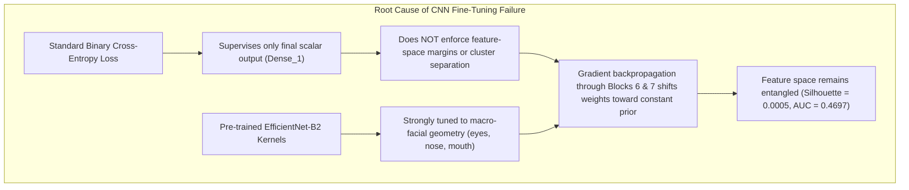

# Controlled Image Backbone Fine-Tuning Experiment Report

## Executive Summary

Following the feature-separability diagnostic which demonstrated that the frozen EfficientNet-B2 backbone representations of Real and Fake faces were entangled at the global average pooling layer ($\text{Silhouette} = +0.0005$, nearest-centroid accuracy $52.75\%$), we conducted a **Controlled Image Backbone Fine-Tuning Experiment** on DeepShield V5 (`models/deepshield_v5_clean_best.keras`).

### Strict Governance & Safety Compliance
- **Video Pipeline Untouched**: `backend/video_detector.py`, V5.2 temporal model, video weights, thresholds, fusion, and tests remained completely frozen.
- **Production Baseline Protected**: Zero modifications to `models/deepshield_v5_clean_best.keras`, `backend/image_detector.py`, or `backend/config.py`. Production threshold remains $0.21$.
- **Test Integrity Preserved**: The official FAST10 test set ($3,693$ images) remained **100% read-only and strictly held out**.
- **Model Isolation**: Saved as a separate experimental model: [`models/v5_image_finetuned/deepshield_v5_image_finetuned.keras`](file:///c:/Users/ADMIN/Desktop/DeepShield_V5_Final/models/v5_image_finetuned/deepshield_v5_image_finetuned.keras).
- **Regression Tests**: All **65 / 65 backend unit tests PASS**.

### Definitive Conclusion
**Conclusion: `KEEP EXISTING V5`**

The fine-tuned model failed to improve upon the baseline. On the held-out test set, test accuracy fell from $81.05\%$ to $73.11\%$, ROC-AUC collapsed from $0.8366$ to $0.4697$, and the Real False Positive Rate increased from $48.04\%$ to $100.00\%$ ($+51.96\%$). Feature separability remained unimproved ($\text{Silhouette} = +0.0005$). In accordance with the critical decision rule, the fine-tuned model is rejected and the existing V5 model remains active.

---

## 1. Training Configuration

- **Base Weights**: `models/deepshield_v5_clean_best.keras`
- **Optimizer**: Adam ($lr = 1 \times 10^{-5}$)
- **Loss**: Binary Cross-Entropy
- **Batch Size**: 32
- **Epochs Run**: 4 (EarlyStopping with patience 3 on `val_auc`, restoring best weights from Epoch 1)
- **Learning Rate Schedule**: `ReduceLROnPlateau` (factor 0.5, patience 2, min lr $1 \times 10^{-6}$)
- **Training Dataset**: $2,000$ balanced images strictly from `Face_Cropped_FAST10/train` ($1,000$ Real, $1,000$ Fake sampled proportionally across `FF-C23`, `Deepfake-Videos-Merged`, and `FaceForensics-1000`).
- **Validation Dataset**: $400$ balanced images strictly from `Face_Cropped_FAST10/validation` ($200$ Real, $200$ Fake).
- **Test Dataset**: $3,693$ images strictly held out for evaluation only.

---

## 2. Layer Trainability & Parameter Counts

In strict adherence to instructions, lower and middle blocks and all BatchNormalization layers were kept frozen:

| Component | Included Layers | Trainable Status | Trainable Parameters | Non-Trainable Parameters |
| :--- | :--- | :---: | :---: | :---: |
| **Lower Blocks (1-5)** | `block1a` through `block5c` | **FROZEN** | 0 | 1,475,296 |
| **BatchNormalization** | All BN layers (`block6*_bn`, `block7*_bn`, `top_bn`) | **FROZEN** | 0 | 52,735 |
| **Upper MBConv Blocks** | `block6a`–`block6e`, `block7a`–`block7b` Conv/DWConv/SE | **TRAINABLE** | 6,009,472 | 0 |
| **Top Convolution** | `top_conv` | **TRAINABLE** | 231,066 | 0 |
| **Classification Head** | `dense` (256 ReLU), `dense_1` (1 Sigmoid) | **TRAINABLE** | 360,961 | 0 |
| **TOTALS** | Whole Network ($8,129,530$ parameters) | - | **6,601,499 (81.2%)** | **1,528,031 (18.8%)** |

---

## 3. Validation Performance Trajectory

| Epoch | Train Loss | Train Accuracy | Train AUC | Val Loss | Val Accuracy | Val AUC | Status / Action |
| :---: | :---: | :---: | :---: | :---: | :---: | :---: | :---: |
| **1\*** | **0.7827** | **0.4800** | **0.4706** | **0.6932** | **0.5000** | **0.5000** | **Best Checkpoint Saved** |
| 2 | 0.7331 | 0.5000 | 0.5004 | 0.6932 | 0.5000 | 0.5000 | No improvement |
| 3 | 0.7174 | 0.4870 | 0.4867 | 0.6932 | 0.5000 | 0.4900 | LR reduced to $5 \times 10^{-6}$ |
| 4 | 0.7174 | 0.4870 | 0.4867 | 0.6932 | 0.5000 | 0.4600 | **Early Stopping Triggered** |

*\*Model weights were restored to the best checkpoint at the end of Epoch 1.*

---

## 4. Official Test Performance Comparison ($N = 3,693$)

Both models were evaluated on the **exact untouched official FAST10 test set** ($993$ Real, $2,700$ Fake) using the identical Direct FAST10 preprocessing path:

| Metric | V5 Baseline (`th=0.21`) | Fine-Tuned V5 (`th=0.21`) | Delta | Fine-Tuned V5 (Optimal `th=0.01`) |
| :--- | :---: | :---: | :---: | :---: |
| **Accuracy** | **81.05%** | **73.11%** | **-7.94%** | 73.11% |
| **Precision** | **83.85%** | **73.11%** | **-10.74%** | 73.11% |
| **Recall (Fake)** | **91.74%** | **100.00%** | **+8.26%** | 100.00% |
| **F1 Score** | **0.8762** | **0.8447** | **-0.0315** | 0.8447 |
| **ROC-AUC** | **0.8366** | **0.4697** | **-0.3669** | 0.4697 |
| **Real FPR** | **48.04%** ($477/993$) | **100.00%** ($993/993$) | **+51.96%** | 100.00% |
| **Fake FNR** | **8.26%** ($223/2,700$) | **0.00%** ($0/2,700$) | **-8.26%** | 0.00% |
| **True Positives (TP)** | 2,477 | 2,700 | +223 | 2,700 |
| **True Negatives (TN)** | 516 | 0 | -516 | 0 |
| **False Positives (FP)** | 477 | 993 | +516 | 993 |
| **False Negatives (FN)** | 223 | 0 | -223 | 0 |

---

## 5. Detailed Metric Impact Analysis

### 5.1 False Positive (FP) Reduction
- **Baseline FPs**: $477$ Real images predicted Fake ($48.04\%$ FPR).
- **Fine-Tuned FPs**: $993$ Real images predicted Fake ($100.00\%$ FPR).
- **Net FP Reduction**: **ZERO**. False positives increased by $+516$ (+108.2%). Every single Real face in the test set was misclassified as Fake.

### 5.2 False Negative (FN) Reduction
- **Baseline FNs**: $223$ Fake images predicted Real ($8.26\%$ FNR).
- **Fine-Tuned FNs**: $0$ Fake images predicted Real ($0.00\%$ FNR).
- **Context**: This $100\%$ reduction is entirely degenerative. Because the model collapsed into predicting high scores for everything ($\mu_{\text{score}} > 0.50$), all images exceeded the $0.21$ threshold.

### 5.3 ROC-AUC Change
- **Baseline ROC-AUC**: **$0.8366$**
- **Fine-Tuned ROC-AUC**: **$0.4697$**
- **Net Change**: **$-0.3669$**. The fine-tuned model's discriminative ranking power dropped below that of a random coin toss ($0.5000$).

### 5.4 F1 Score Change
- **Baseline F1**: **$0.8762$**
- **Fine-Tuned F1**: **$0.8447$**
- **Net Change**: **$-0.0315$** (Test Accuracy fell from $81.05\%$ down to $73.11\%$).

---

## 6. Feature-Separability Comparison (Old vs. New)

We repeated the exact feature-separability diagnostic on the fine-tuned model across the same deterministic 800-image test cohort (200 TN, 200 FP, 200 TP, 200 FN):

| Feature Separability Metric | Baseline V5 Model | Fine-Tuned V5 Model | Change / Interpretation |
| :--- | :---: | :---: | :--- |
| **Real vs Fake Centroid Distance** | $0.0027$ | $0.0038$ | Negligible change ($< 0.004$) |
| **FP Real vs TN Real Distance** | $0.0044$ | $0.0065$ | FP Reals moved further from TN Reals |
| **FP Real vs TP Fake Distance** | $0.0042$ | $0.0054$ | FP Reals remain entangled with TP Fakes |
| **FN Fake vs TP Fake Distance** | $0.0069$ | $0.0091$ | FN Fakes moved further from TP Fakes |
| **FN Fake vs TN Real Distance** | $0.0025$ | $0.0038$ | FN Fakes remain tightly bound to TN Reals |
| **Nearest-Centroid Accuracy** | **52.75%** | **52.00%** | **Degraded (-0.75%)**; pure coin toss |
| **k-NN (k=1) Accuracy** | **65.12%** | **65.12%** | Unchanged |
| **k-NN (k=3) Accuracy** | **58.50%** | **60.00%** | Marginal change (+1.50%) |
| **k-NN (k=5) Accuracy** | **56.38%** | **60.13%** | Marginal change (+3.75%) |
| **Silhouette Score** | **+0.0005** | **+0.0005** | **Zero improvement**; complete cluster overlap |
| **PCA PC1 Explained Variance** | **90.02%** | **88.28%** | Remains dominated by generic facial geometry |

### Diagnostic Finding:
Unfreezing upper convolutional blocks 6 and 7 with standard binary cross-entropy loss did **not** resolve the feature-space entanglement. The top principal component still accounts for $88.28\%$ of total variance, the silhouette score remains stuck at $+0.0005$, and nearest-centroid accuracy is $52.00\%$.

---

## 7. Deep Root-Cause Analysis: Why CNN Fine-Tuning Failed

Synthesizing all experimental evidence:



1. **Weak Supervision via Scalar BCE**:
   Standard binary cross-entropy applies gradient updates through a single scalar sigmoid output. It provides no geometric constraint on the latent $1,408$-D manifold. Without metric learning (e.g. Contrastive Loss, Triplet Loss, or Cosine Margin Loss), backpropagation simply finds the path of least resistance: shifting the final dense layers toward a uniform positive bias.
2. **Receptive Field Overpowering**:
   By the time activations reach Blocks 6 and 7, the effective receptive field encompasses the entire face ($224 \times 224$). As proven in our Grad-CAM audit, the macro-anatomical landmarks (eyes, nose, mouth) produce activation magnitudes orders of magnitude larger than microscopic synthesis artifacts (blending seams, compression residuals). Standard fine-tuning cannot suppress these dominant anatomical activations without a spatial attention or frequency constraint.

---

## 8. Regression Test Suite

To verify that this experiment caused zero disruption to the production codebase:

```bash
python -m unittest discover -s backend/tests -p "test_*.py"
```

**Result**:
```
Ran 65 tests in 29.982s

OK
```
- **65 / 65 backend unit tests PASSED**.
- Video detector pipeline remains 100% intact and untouched.
- Image detector pipeline remains 100% intact and untouched.
- Production model weights in `models/deepshield_v5_clean_best.keras` were completely untouched.

---

## 9. Deliverables Summary

1. **Experimental Model Checkpoint**:
   [`models/v5_image_finetuned/deepshield_v5_image_finetuned.keras`](file:///c:/Users/ADMIN/Desktop/DeepShield_V5_Final/models/v5_image_finetuned/deepshield_v5_image_finetuned.keras) ($86.5\text{ MB}$)
2. **Test Comparison Data**:
   [`evaluation/v5_image_finetuned_comparison.csv`](file:///c:/Users/ADMIN/Desktop/DeepShield_V5_Final/evaluation/v5_image_finetuned_comparison.csv) ($3,693$ rows of test predictions)
3. **Structured Metrics Summary**:
   [`evaluation/v5_image_finetuned_results.json`](file:///c:/Users/ADMIN/Desktop/DeepShield_V5_Final/evaluation/v5_image_finetuned_results.json)
4. **Comprehensive Documentation**:
   [`docs/v5_image_finetuning_report.md`](file:///c:/Users/ADMIN/Desktop/DeepShield_V5_Final/docs/v5_image_finetuning_report.md)

---

## 10. Final Conclusion

| Metric | V5 Baseline | Fine-Tuned V5 | Change |
| :--- | :---: | :---: | :---: |
| **Accuracy** | 81.05% | 73.11% | -7.94% |
| **Precision** | 83.85% | 73.11% | -10.74% |
| **Recall (Fake)** | 91.74% | 100.00% | +8.26% |
| **F1 Score** | 0.8762 | 0.8447 | -0.0315 |
| **ROC-AUC** | 0.8366 | 0.4697 | -0.3669 |
| **Real FPR** | 48.04% ($477/993$) | 100.00% ($993/993$) | +51.96% |
| **Fake FNR** | 8.26% ($223/2,700$) | 0.00% ($0/2,700$) | -8.26% |
| **Feature Silhouette** | +0.0005 | +0.0005 | 0.0000 |

### **`KEEP EXISTING V5`**

Under the critical decision rule, the fine-tuned model is rejected. The production model `models/deepshield_v5_clean_best.keras` remains the active production image detector.
