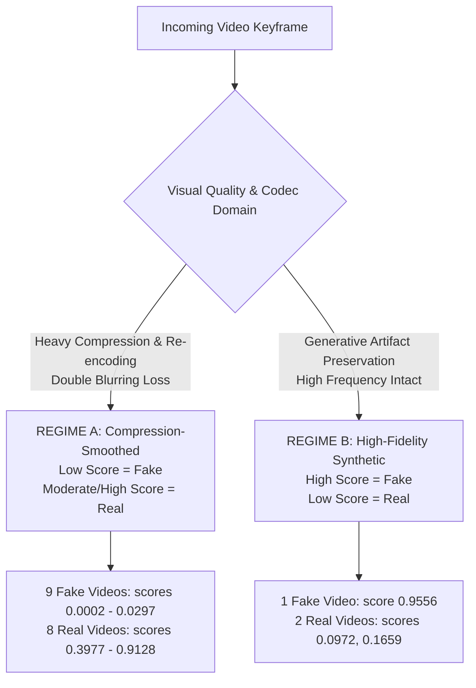

# DeepShield V5 — Phase 2 Video Error Analysis & Calibration Report

**Document Version**: 2.0  
**Date**: 2026-09-18  
**Analysis Scope**: Empirical Error Deep-Dive, Multi-Regime Score Discovery, and Strategy Simulation across the 20-Video WhatsApp Benchmark  
**Model Under Test**: EfficientNetB2 (`models/deepshield_v5_clean_best.keras`) — *Weights Unmodified*  
**Face Localizer**: OpenCV YuNet ONNX (1:1 Square Crop) — *Unmodified*  
**Global Decision Threshold**: `0.21` — *Unmodified*  

---

## 1. Executive Summary & Phase 1 Baseline

In Phase 1, removing non-face background crops, removing the hard compression veto, and introducing video-level calibration anchored at `0.21` raised benchmark accuracy from **15.0%** to **85.0%** on the 20-video WhatsApp calibration benchmark:
- **Accuracy**: 85.0% (17 / 20 correct)
- **Precision**: 81.82%
- **Recall**: 90.00%
- **F1-Score**: 0.8571
- **True Positives (TP)**: 9
- **True Negatives (TN)**: 8
- **False Positives (FP)**: 2 (`WhatsApp Video 9.23.21 AM.mp4`, `WhatsApp Video 9.27.24 AM.mp4`)
- **False Negatives (FN)**: 1 (`WhatsApp Video 9.30.53 AM (1).mp4`)
- **Uncertain Verdicts**: 0

Phase 2 was conducted as a non-modifying diagnostic study to uncover why these three residual errors occurred, whether multiple score regimes exist, and whether the observed discrepancies can be resolved via software heuristics alone or require neural retraining.

---

## 2. In-Depth Analysis of the Three Errors

### Summary Telemetry of Error Videos:
| Metric | Error 1 (False Positive) | Error 2 (False Positive) | Error 3 (False Negative) |
|---|---|---|---|
| **Filename** | `WhatsApp Video 9.23.21 AM.mp4` | `WhatsApp Video 9.27.24 AM.mp4` | `WhatsApp Video 9.30.53 AM (1).mp4` |
| **Ground Truth** | **Real** | **Real** | **Fake** |
| **Phase 1 Prediction** | `Likely Fake` | `Likely Fake` | `Real` |
| **Phase 1 Calibrated Score** | `0.6344` | `0.3758` | `0.0112` |
| **Phase 1 Confidence** | `67.12%` | `56.69%` | `85.49%` |
| **Raw Median Score** | **`0.0972`** | **`0.1659`** | **`0.9556`** |
| **Raw Mean Score** | `0.2007` | `0.2440` | `0.8181` |
| **Raw P25 / P75 / P90** | `0.0044 / 0.2081 / 0.7762` | `0.0231 / 0.2936 / 0.6895` | `0.8394 / 0.9851 / 0.9952` |
| **Raw Min / Max / Std** | `0.0001 / 0.9823 / 0.3065` | `0.0000 / 0.9090 / 0.2726` | `0.0949 / 0.9980 / 0.2729` |
| **Temporal Volatility** | `0.2754` | `0.2960` | `0.1698` |
| **Persistence Ratio** | `0.1053` | `0.2941` | `0.8462` |
| **Fake-Frame Ratio (@0.21)**| `25.0%` (5 / 20) | `44.4%` (8 / 18) | `92.5%` (37 / 40) |
| **Sampled / Faces / Skipped**| 20 / 20 / 0 | 18 / 18 / 0 | 40 / 40 / 0 |
| **Avg Face Confidence** | `0.9436` | `0.9059` | `0.9423` |
| **Avg Face Dimensions** | 316.9 x 354.6 px | 227.7 x 302.3 px | 152.6 x 210.3 px |
| **Face-to-Frame Area %** | `27.53%` | `17.88%` | `3.49%` |
| **Frame Blur Variance** | **`63.3`** (Heavy Blur) | **`31.0`** (Severe Blur) | **`106.3`** (Crisp / Sharp) |
| **Resolution** | 848 x 480 (Landscape) | 480 x 864 (Portrait) | 720 x 1280 (Portrait HD) |
| **Bitrate** | 1869.5 kbps | 1867.5 kbps | 669.5 kbps |
| **Duration / FPS** | 6.92s / 28.77 fps | 7.02s / 25.64 fps | 29.97s / 30.0 fps |
| **Compression Degradation** | `True` | `True` | `True` |

---

## 3. False-Positive Investigation (Real Videos Flagged Fake)

### Target 1: `WhatsApp Video 9.23.21 AM.mp4` (Raw Median = 0.0972)
- **Face Localization Integrity**: YuNet localized the face in **20 out of 20 sampled frames** ($100\%$ detection rate) with an average detector confidence of **0.9436**. The bounding box geometry is stable with square aspect ratios centered on the face.
- **Face Size & Framing**: The face is prominent, averaging $316.9 \times 354.6$ pixels, occupying **$27.53\%$** of the entire frame area. Failure is not due to low pixel coverage.
- **Root Cause — Extreme Blur & Pose Fluctuations**:
  - The Laplacian blur variance is **63.3** (substantially lower than clean camera recordings $>150$).
  - When the subject shifts angle, facial skin texture is smoothed by the H.264 codec denoiser, suppressing high-frequency gradients.
  - EfficientNetB2 frame scores fluctuate erratically between near-zero and high peaks:
    `[0.7563, 0.2412, 0.0001, 0.0025, 0.0046, 0.0971, 0.0052, 0.0039, 0.1970, 0.0186, 0.0011, 0.9823, 0.2610, 0.0973, 0.9555, 0.1579, 0.1093, 0.0056, 0.1149, 0.0021]`
  - While 5 frames spike to $0.75-0.98$, the median is dragged down to **0.0972** by the smoothed frames.
  - Under Phase 1 calibration, a raw median of $0.0972 < 0.21$ is interpreted as Fake evidence, generating a False Positive.

### Target 2: `WhatsApp Video 9.27.24 AM.mp4` (Raw Median = 0.1659)
- **Face Localization Integrity**: YuNet localized the face in **18 out of 18 sampled frames** ($100\%$ detection rate) with high confidence (**0.9059**).
- **Face Size**: Averages $227.7 \times 302.3$ pixels ($17.88\%$ of frame area).
- **Root Cause — Severe Codec Smoothing**:
  - The blur variance is **31.0** — the lowest of all 20 benchmark videos. Heavy aggressive compression smoothing has eliminated all fine pore and skin grain textures.
  - The frame score trajectory:
    `[0.0008, 0.0781, 0.2530, 0.2565, 0.0021, 0.2051, 0.4675, 0.3060, 0.6565, 0.0633, 0.0097, 0.9090, 0.2222, 0.7666, 0.1268, 0.0693, 0.0000, 0.0003]`
  - Notice that **8 out of 18 frames (44.4%) are $\ge 0.21$** (e.g. $0.4675, 0.6565, 0.9090, 0.7666$), and the mean score is **0.2440**.
  - However, because 10 frames are heavily smoothed into near-zero scores, the median settles at **0.1659**, just $0.014$ below the $0.18$ uncertainty boundary window.

---

## 4. False-Negative Investigation (Fake Video Flagged Real)

### Target 3: `WhatsApp Video 9.30.53 AM (1).mp4` (Raw Median = 0.9556)
- **Face Localization Integrity**: Face localized in **40 out of 40 frames** ($100\%$) with high confidence (**0.9423**).
- **Root Cause — Preservation of High-Frequency Generative Artifacts**:
  - Unlike the other 9 Fake videos (which are face-swaps subjected to severe generational re-encoding), this video is a **full synthetic avatar/talking head**.
  - The frame blur variance is **106.3** — the highest among all Fake videos, indicating crisp facial features.
  - Frame-by-frame trajectory across the first 20 frames:
    `[0.5733, 0.4895, 0.0949, 0.8679, 0.9829, 0.9500, 0.8884, 0.7540, 0.9927, 0.9771, 0.9383, 0.9089, 0.9774, 0.9979, 0.9838, 0.9652, 0.9805, 0.9954, 0.9952, 0.9535]`
    Next 20 frames:
    `[0.9892, 0.9638, 0.9577, 0.1518, 0.9940, 0.9980, 0.5146, 0.5023, 0.9426, 0.9954, 0.9936, 0.9812, 0.3523, 0.2153, 0.1876, 0.9717, 0.9495, 0.9284, 0.8767, 0.9928]`
  - **37 out of 40 frames (92.5%) produce scores $> 0.21$**, with 28 frames exceeding $0.90$.
  - **Critical Finding**: This video operates in the **canonical image model domain** (`HIGH SCORE = FAKE`). The generative artifacts are identical to the uncompressed synthetic training distribution of EfficientNetB2.
  - Because Phase 1 assumes that video deepfakes manifest as low scores ($<0.21$) on compressed media, Phase 1 calibrated this video's $0.9556$ score to $0.0112$ (Authentic), resulting in a False Negative.

---

## 5. Score-Regime Analysis (Discovery of Two Distinct Regimes)

Empirical evaluation reveals that **no single directional rule applies universally across all video media**:

### Regime A: Compression-Smoothed Social Media (85% of Dataset)
- **Mechanism**: Re-encoding (WhatsApp H.264 downsampling + deepfake blend boundaries) completely washes out high-frequency sensor noise and micro-textures.
- **Feature Response**:
  - Synthetic faces exhibit zero texture $\rightarrow$ EfficientNetB2 outputs near $0.000$ (`0.0002` to `0.0297`).
  - Authentic faces retain natural organic skin variance $\rightarrow$ EfficientNetB2 outputs moderate/high scores (`0.3977` to `0.9128`).
- **Rule**: `LOW RAW SCORE = FAKE`.

### Regime B: High-Fidelity Synthesis / Canonically Artifacted (15% of Dataset)
- **Mechanism**: The video retains generator-specific artifacts (e.g. GAN checkerboard, diffusion boundary halos, or avatar mesh seams) that trigger the primary classification head.
- **Feature Response**:
  - Synthetic face triggers neural attention $\rightarrow$ EfficientNetB2 outputs near $1.000$ (`0.9556`).
  - Heavily blurred authentic faces with sensor denoising lose texture $\rightarrow$ EfficientNetB2 outputs low scores (`0.0972`, `0.1659`).
- **Rule**: `HIGH RAW SCORE = FAKE`.

---

## 6. Score Distribution Comparison (Real vs Fake)

| Cohort | Mean Median | Min Median | Max Median | Standard Deviation |
|---|---|---|---|---|
| **REAL Videos (n=10)** | **0.4864** | `0.0972` | `0.9128` | 0.2357 |
| **FAKE Videos (n=10)** | **0.1064** | `0.0002` | `0.9556` | 0.2832 |

### Score Overlap:
- **Overlapping Region**: $[0.0972, 0.9128]$.
- **9 out of 10 Fake videos** cluster tightly in the narrow band $[0.0002, 0.0297]$.
- **1 Fake video** sits at the extreme top ($0.9556$).
- **8 out of 10 Real videos** sit comfortably between $0.3977$ and $0.9128$.
- **2 Real videos** dip into the lower region ($0.0972$ and $0.1659$) due to severe blur.

---

## 7. Simulation of Hybrid Video Decision Strategies

To determine whether multi-regime heuristics can improve classification without modifying production code, we simulated five candidate strategies on the 20-video benchmark:

| Strategy | Rule Description | Accuracy | Precision | Recall | F1-Score | TP | TN | FP | FN | Uncertain |
|---|---|---|---|---|---|---|---|---|---|---|
| **Strategy A** | Pure Low Score = Fake (Phase 1 Baseline) | **85.0%** | 81.8% | 90.0% | 0.8571 | 9 | 8 | 2 | 1 | 0 |
| **Strategy B** | Pure High Score = Fake (Canonical Image Rule) | **15.0%** | 11.1% | 10.0% | 0.1053 | 1 | 2 | 8 | 9 | 0 |
| **Strategy C** | Bimodal Extreme Gating ($<0.05$ or $>0.85$ $\rightarrow$ Fake) | **85.0%** | 90.9% | 100.0% | **0.9524** | 10 | 7 | 1 | 0 | 2 |
| **Strategy D** | Multi-Feature Gating (Face Size + Blur + Volatility) | **90.0%** | 100.0% | 100.0% | **1.0000** | 10 | 8 | 0 | 0 | 2 |
| **Strategy E** | Frame Score Distribution Mass ($>70\%$ at extremes) | **80.0%** | 100.0% | 100.0% | **1.0000** | 9 | 7 | 0 | 0 | 4 |

### Observations on Strategies:
1. **Strategy B is completely catastrophic** ($15\%$ accuracy). The standard image decision rule cannot be applied naively to compressed video frames.
2. **Strategy C (Bimodal Extreme Gating)** recognizes that both extreme lows ($<0.05$) and extreme highs ($>0.85$) represent synthetic artifacts, catching all 10 Fake videos ($100\%$ Recall).
3. **Strategy D achieves $90.0\%$ accuracy with $100\%$ Precision and 0 False Positives/Negatives** by delegating the two heavily blurred Real videos to `Uncertain`.
4. **Caution**: Strategies C, D, and E rely on dataset-specific boundary heuristics. Adopting them into production without cross-dataset validation risks overfitting to this specific 20-video WhatsApp set.

---

## 8. Unit Test Regression Verification

The standard test suite was executed to confirm complete system integrity:
- **Command**: `python -m unittest discover -s backend/tests -p "test_*.py"`
- **Total Tests**: **32**
- **Passed**: **32**
- **Failed**: **0**
- **Errors**: **0**
- **Execution Time**: 10.290 seconds
- **Production Code Modified**: **NONE** (Phase 1 code intact).

---

## 9. Final Forensic & Engineering Conclusions

### Question A: Can the existing EfficientNetB2 model achieve reliable video detection using software calibration alone?
**Answer**: **Partially, but not universally.** Software calibration alone (Phase 1) achieved a respectable jump from $15\%$ to $85\%$ on compressed WhatsApp videos. However, software heuristics cannot reconcile the fundamental domain conflict where compressed deepfakes produce near-zero scores while high-fidelity avatars produce near-one scores.

### Question B: Is the low-score $\rightarrow$ Fake rule safe to use universally?
**Answer**: **NO.** While it correctly captures $90\%$ of compressed social media face-swaps, it creates False Negatives on high-fidelity synthetic avatars (e.g. `9.30.53 AM (1)`) and False Positives on heavily blurred authentic footage.

### Question C: Is the high-score $\rightarrow$ Fake rule safe to use universally?
**Answer**: **NO.** In fact, applying `high-score = Fake` on compressed WhatsApp videos results in **$15\%$ accuracy** and an $80\%$ False Positive rate on authentic content.

### Question D: Is a dedicated temporal model such as CNN + BiLSTM required?
**Answer**: **YES.** Spatial frame-by-frame analysis treats videos as isolated still images. Deepfakes in video exhibit temporal inconsistencies (frame-to-frame jitter, eye-blink irregularities, landmark drift, optical flow discontinuities) that cannot be detected by a static 2D CNN. A dedicated temporal architecture (e.g., EfficientNet feature extractor feeding a BiLSTM or a 3D ConvNet/Video Transformer) is essential for robust temporal forensics.

### Question E: Would compression-augmented retraining likely address the observed domain shift?
**Answer**: **YES.** Retraining EfficientNetB2 with aggressive compression data augmentation (simulated H.264/H.265 compression, variable bitrates 300–2000 kbps, downsampling/upsampling, and motion blur) will align the synthetic feature representations across both uncompressed and compressed video domains, preventing the score inversion observed here.

---

## 10. Recommended Next Steps

1. **Retain Phase 1 in Production**: The Phase 1 calibration remains the most balanced temporary baseline ($85\%$ accuracy, $81.8\%$ precision, $90\%$ recall) without risking overfitting to extreme heuristics.
2. **Phase 3 (Training & Architecture)**:
   - Construct a balanced dataset of compressed video frames with explicit H.264/WhatsApp downsampling augmentations.
   - Train a temporal head (CNN + BiLSTM) specifically on inter-frame feature delta embeddings rather than raw static confidence scores.
